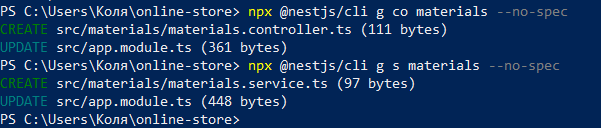
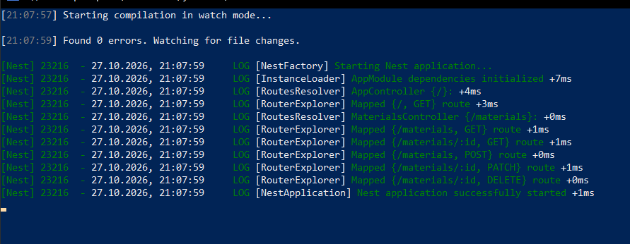
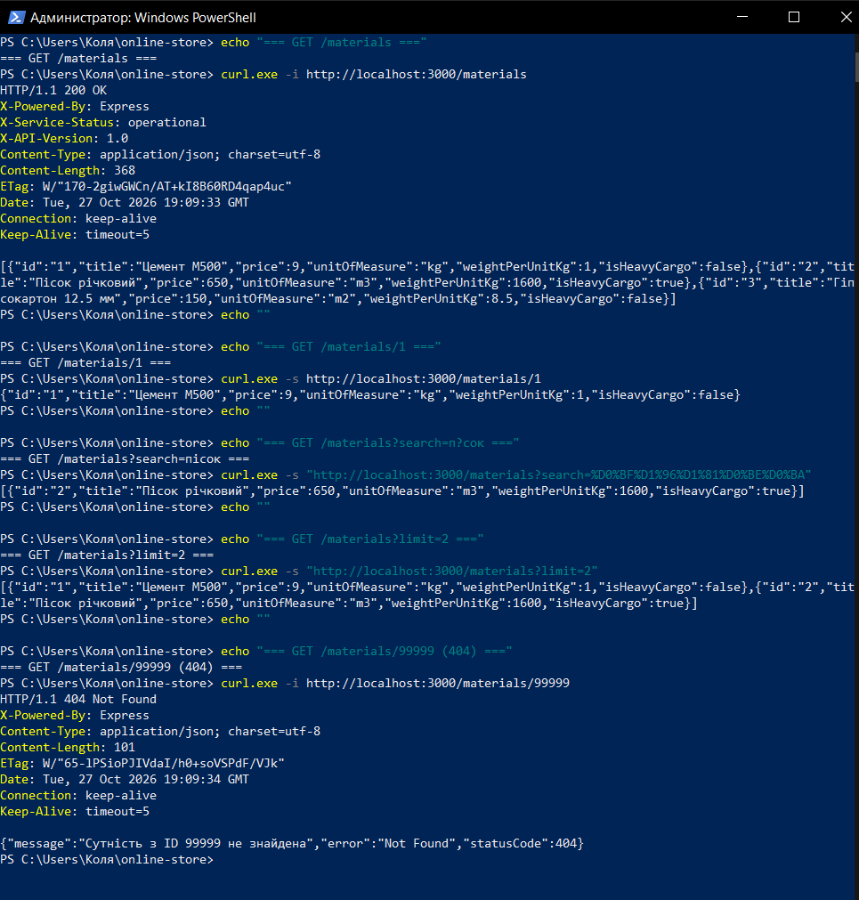
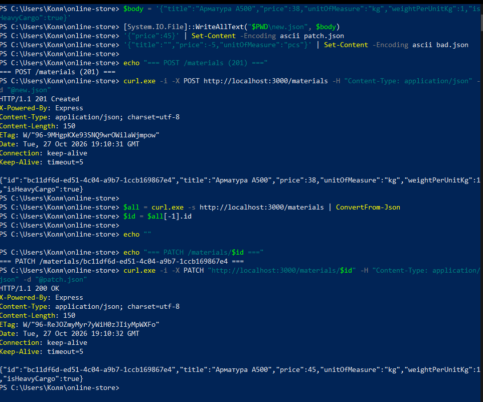
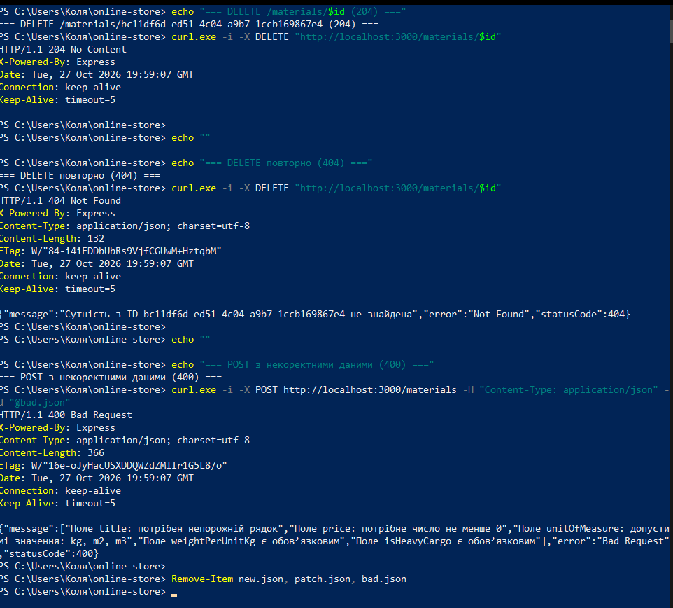

# Практична робота № 4

**Тема:** Розроблення REST-ендпоінтів засобами NestJS

**Виконав:** Дурицький М.М., група КН-43

**Варіант:** 6 (будівельні матеріали, ресурс `/materials`)

## Опис

REST API ресурсу `materials` на NestJS: контролер, сервіс із in-memory сховищем, DTO-класи, обробка помилок через вбудовані HTTP-виключення, пошук і обмеження кількості записів через query-параметри та службові заголовки відповіді.

Модель матеріалу (варіант 6):

| Поле | Тип |
|------|-----|
| `id` | `string` |
| `title` | `string` |
| `price` | `number` |
| `unitOfMeasure` | `'kg' \| 'm2' \| 'm3'` |
| `weightPerUnitKg` | `number` |
| `isHeavyCargo` | `boolean` |

## Середовище

- Windows, PowerShell
- Node.js v22.23.3, npm
- NestJS CLI 12.0.11 (проєкт створено з модульною системою ESM і vitest)
- Visual Studio Code + розширення REST Client (для `requests.http`)

## Структура проєкту

```
online-store/
├── requests.http                       - запити для REST Client
├── README.md
├── screenshots/
└── src/
    ├── main.ts
    ├── app.module.ts                   - реєстрація контролера і сервісу
    └── materials/
        ├── materials.controller.ts     - маршрути /materials
        ├── materials.service.ts        - in-memory сховище, CRUD, валідація
        ├── dto/
        │   ├── create-material.dto.ts
        │   └── update-material.dto.ts
        └── entities/
            └── material.entity.ts
```

## Запуск

```powershell
npm install --legacy-peer-deps
npm run start:dev
```

Сервер стартує на `http://localhost:3000`. Запити з `requests.http` виконуються кнопкою **Send Request** у VS Code (розширення REST Client).

Примітки:

- Прапорець `--legacy-peer-deps` потрібен, бо звичайний `npm install` у цьому проєкті завершується помилкою через конфлікт peer-залежностей.
- Проєкт використовує ESM, тому імпорти між власними файлами пишуться з розширенням `.js`.
- Дані зберігаються в пам'яті процесу, після перезапуску сервера повертаються початкові три записи.

---

## Рівень 1. Створення проєкту та ендпоінти

**Ініціалізація та генерація** (команди CLI):

```powershell
npx @nestjs/cli new online-store --strict --package-manager npm
cd online-store
npx @nestjs/cli g co materials --no-spec
npx @nestjs/cli g s materials --no-spec
```

CLI створив `materials.controller.ts` та `materials.service.ts` і сам оновив `src/app.module.ts` (рядки `UPDATE src/app.module.ts`), тобто контролер і сервіс автоматично зареєстровані в `AppModule`.



**DTO** (`src/materials/dto/`): `CreateMaterialDto` з обов'язковими полями (`title`, `price`, `unitOfMeasure`, `weightPerUnitKg`, `isHeavyCargo`) і `UpdateMaterialDto` із тими самими полями, але необов'язковими.

**Базові методи контролера:** `@Get()` (список), `@Get(':id')` (читає `@Param('id')`), `@Post()` (читає `@Body() createDto: CreateMaterialDto`).

---

## Рівень 2. CRUD, HTTP-статуси та In-Memory Service

**Сервіс** (`MaterialsService`, `@Injectable()`) зберігає дані в `private items: Material[]` із трьома початковими записами (цемент, пісок, гіпсокартон).

| Метод сервісу | Поведінка |
|---------------|-----------|
| `findAll(search?, limit?)` | повертає всі записи (з фільтрами з рівня 3) |
| `findOne(id)` | шукає за `id`, якщо немає, то `NotFoundException("Сутність з ID ... не знайдена")` |
| `create(dto)` | перевіряє дані, формує запис з унікальним `id` через `randomUUID()` |
| `update(id, dto)` | знаходить запис (інакше `NotFoundException`), змінює лише передані поля, `id` не змінюється |
| `remove(id)` | видаляє запис, якщо його немає, то `NotFoundException` |

**Dependency Injection:** сервіс впроваджується в контролер через конструктор (`constructor(private readonly materialsService: MaterialsService) {}`), а методи контролера лише делегують виклики сервісу.

**HTTP-статуси:** для `@Post()` явно встановлено `@HttpCode(HttpStatus.CREATED)` (201), для `@Delete(':id')` `@HttpCode(HttpStatus.NO_CONTENT)` (204).

**Валідація:** тіло запиту приходить як довільний JSON, тому сервіс вручну перевіряє типи й значення (непорожня назва, ціна й вага не менші за 0, `unitOfMeasure` зі списку `kg`/`m2`/`m3`, `isHeavyCargo` булеве). Для некоректних даних кидається `BadRequestException` зі списком помилок по полях.

---

## Рівень 3. Query-фільтрація, заголовки та тестування

**Query-параметри** в `@Get()`:

```ts
@Get()
@Header('X-API-Version', '1.0')
@Header('X-Service-Status', 'operational')
findAll(@Query('search') search?: string, @Query('limit') limit?: string) {
  return this.materialsService.findAll(search, limit);
}
```

- `search` фільтрує за підрядком у `title` без урахування регістру (`toLowerCase()`).
- `limit` обмежує кількість записів, значення має бути додатним цілим числом, інакше `400 Bad Request`.
- Декоратори `@Header` додають до відповіді заголовки `X-API-Version: 1.0` та `X-Service-Status: operational`.

**Файл `requests.http`** у корені проєкту містить 10 запитів: список, пошук, `limit`, існуючий запис, неіснуючий запис (404), створення (201), некоректні дані (400), `PATCH`, `DELETE` (204) і повторний `DELETE` (404).

---

## Результати тестування

### Запуск сервера

Компіляція без помилок (`Found 0 errors`), усі маршрути `/materials` змаплені.



### GET-запити



| Запит | Результат |
|-------|-----------|
| `GET /materials` | `200 OK`, три матеріали; у заголовках `X-API-Version: 1.0`, `X-Service-Status: operational` |
| `GET /materials/1` | `200 OK`, запис «Цемент М500» |
| `GET /materials?search=пісок` | `200 OK`, один запис «Пісок річковий» |
| `GET /materials?limit=2` | `200 OK`, два записи |
| `GET /materials/99999` | `404 Not Found`, `"Сутність з ID 99999 не знайдена"` |

### POST і PATCH



| Запит | Результат |
|-------|-----------|
| `POST /materials` | `201 Created`, створено «Арматура А500» зі згенерованим UUID |
| `PATCH /materials/:id` з `{"price": 45}` | `200 OK`, змінилась лише ціна (38 на 45), решта полів і `id` без змін |

### DELETE і валідація



| Запит | Результат |
|-------|-----------|
| `DELETE /materials/:id` | `204 No Content`, тіла відповіді немає |
| повторний `DELETE` | `404 Not Found` |
| `POST` з порожньою назвою, від'ємною ціною та `unitOfMeasure: "pcs"` | `400 Bad Request` зі списком помилок по полях `title`, `price`, `unitOfMeasure`, `weightPerUnitKg`, `isHeavyCargo` |

---

## Відповіді на контрольні питання

**1. Що таке Inversion of Control та як Dependency Injection реалізований у NestJS?**
Інверсія керування означає, що об'єкти не створюють свої залежності самі, а отримують їх ззовні. У NestJS це робить вбудований IoC-контейнер: класи з `@Injectable()` реєструються як провайдери в `providers` модуля, а залежності вказуються у конструкторі (`constructor(private readonly materialsService: MaterialsService)`). Nest сам створює екземпляр сервісу (за замовчуванням один на застосунок) і передає його в контролер.

**2. Різниця між `@Module`, `@Controller` та `@Injectable`.**
`@Module` групує пов'язані контролери та провайдери й описує, що модуль підключає та експортує. `@Controller` приймає HTTP-запити за заданими маршрутами та повертає відповіді. `@Injectable` позначає провайдер (сервіс, репозиторій тощо), який контейнер може створювати та впроваджувати в інші класи; у ньому живе бізнес-логіка.

**3. Чому DTO це класи, а не інтерфейси?**
Інтерфейси існують лише на етапі компіляції й зникають у JavaScript. Клас залишається в runtime, тому Nest може використовувати його як токен типу (`design:paramtypes`), а пайпи валідації (наприклад `ValidationPipe` із `class-validator`) можуть працювати з декораторами на полях. Також клас можна розширювати й використовувати як значення.

**4. Які декоратори витягують параметри запиту?**
`@Param('id')` для параметрів маршруту (`/materials/:id`), `@Query('search')` для query-параметрів (`?search=...`), `@Body()` для тіла запиту (`@Body() createDto: CreateMaterialDto`). Також є `@Headers()`, `@Req()` та `@Res()`.

**5. Який статус за замовчуванням повертають GET, POST та DELETE? Як його змінити?**
`GET` повертає `200 OK`, `POST` повертає `201 Created`, `DELETE` повертає `200 OK` (Nest змінює за замовчуванням лише статус POST). Змінити можна декоратором `@HttpCode(...)`, наприклад `@HttpCode(HttpStatus.NO_CONTENT)` над методом `remove` дає `204`.

**6. Як працює обробка виключень? Що повертається при `throw new NotFoundException()`?**
У Nest є вбудований глобальний фільтр виключень, який перехоплює виключення типу `HttpException` (до нього належать `NotFoundException`, `BadRequestException` тощо) і перетворює їх на HTTP-відповідь. Для `NotFoundException('текст')` клієнт отримує статус `404` і JSON `{"message": "текст", "error": "Not Found", "statusCode": 404}`, як у нашому тесті з `/materials/99999`.

**7. Як додати власний заголовок відповіді через `@Header()`?**
Декоратор вішається на метод контролера й приймає назву та значення заголовка: `@Header('X-API-Version', '1.0')`. Можна ставити кілька декораторів підряд, у роботі це `X-API-Version` та `X-Service-Status`.

**8. Різниця між `PUT` та `PATCH`.**
`PUT` повністю замінює ресурс, тому клієнт має передати всі поля, а відсутні можуть бути скинуті. `PATCH` змінює ресурс частково: передаються лише змінювані поля, решта лишається як була. У роботі для цього `UpdateMaterialDto` із необов'язковими полями й метод `@Patch(':id')`.

---

## Висновки

За допомогою NestJS CLI створено проєкт, згенеровано контролер і сервіс, описано DTO-класи. Реалізовано повний REST CRUD для ресурсу `materials` із in-memory сховищем, впровадженням залежностей через конструктор, коректними HTTP-статусами (200, 201, 204, 400, 404) та вбудованими виключеннями NestJS. Додано фільтрацію `search` і `limit` через query-параметри та службові заголовки `X-API-Version` і `X-Service-Status`. Усі ендпоінти перевірено запитами, результати наведено в цьому файлі.
